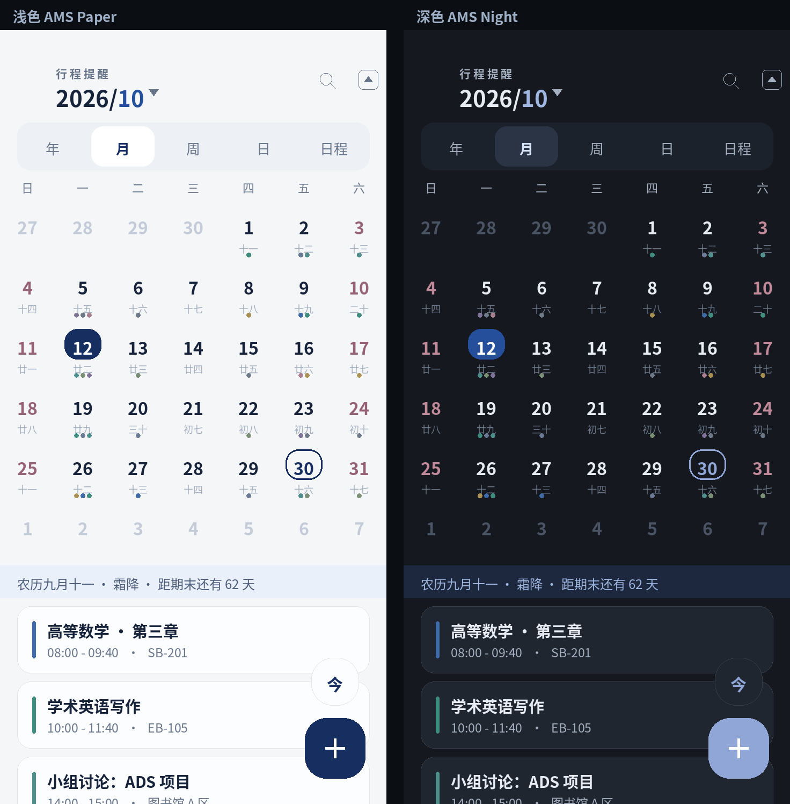

# 行程提醒 · Schedule Reminder

一个**纯 Java 原生**的 Android 日程 / 课表应用。没有 Gradle、没有第三方依赖、没有一行 Kotlin——直接从 `aapt2` + `javac` + `d8` + `apksigner` 手工构建，APK 约 **155 KB**。



> 左：浅色　右：深色（按实际绘制参数复算的设计预览）

## 特性

- **五种视图**：年 / 月 / 周 / 日 / 议程列表，全部自绘（`Canvas`），跟手翻页、松手吸附
- **农历与节气**：1900–2100 的农历引擎（`Lunar.java`），月视图每格带农历小字，顶部干支信息条
- **重复日程**：每天 / 每周 / 双周 / 每月 / 指定多日期，支持截止日期
- **提醒链路**：`AlarmManager.setAlarmClock` 精确闹钟 + 开机重排 + 通知「稍后提醒」
- **分类管理**：改名 / 换色 / 删除，**按住右侧手柄拖动排序**，顺序影响新建日程时的分类排列
- **AI 添加日程**：接入任意 OpenAI 兼容接口，说人话自动解析成日程（日期换算、全天、重复、提醒、分类匹配），先预览再写入
- **导入导出**：JSON / 正则文本双通道导入，JSON 全量导出
- **桌面小组件**：今日行程小组件
- **深浅色**：跟随系统的两套完整色板

## 界面设计

视觉语言取自校园类应用的「纸面 + 细线」风格，并遵循日历设计的通用规则：

| 项 | 取值 |
|---|---|
| 主色 | `#172E61`（只用于选中 / 今天 / 主按钮） |
| 画布 / 卡面 | `#F5F6F8` / `#FCFDFE`（深色 `#15191F` / `#202630`） |
| 圆角 | 卡片 13dp、弹层 16dp、FAB 20dp |
| 网格 | 4dp 基线：月格 56dp、视图栏 44dp、卡间距 8dp |
| 今日 vs 选中 | **今日是描边环、选中是实心块**——不靠颜色区分，形状就能分辨 |
| 数字 | 全部等宽数字（`tnum`），翻页时时间不跳字 |
| 触控 | 图标 40dp、主按钮 48dp |
| 分类色板 | 低饱和 9 色，与删除红（`#C0453F`）、周末色分开 |

无障碍：图标与日期格带 `contentDescription`，月历播报「已选 X 月 X 日 星期 X，当天 N 个行程」，按压动效尊重系统「减少动态效果」。

## 构建

需要三样东西：`build-tools`（aapt2 / zipalign / apksigner）、`android.jar`、`r8.jar`。

```bash
# 1) 准备工具链（示例：腾讯云镜像）
curl -O https://mirrors.cloud.tencent.com/AndroidSDK/build-tools_r34-linux.zip
curl -O https://mirrors.cloud.tencent.com/AndroidSDK/platform-35_r01.zip
curl -O https://mirrors.cloud.tencent.com/nexus/repository/maven-public/com/android/tools/r8/9.5.23/r8-9.5.23.jar

# 2) 设置工具链目录与签名口令
export ANDROID_TOOLS=/path/to/tools   # 内含 android-14/（build-tools）与 android-35/android.jar
export KS_PASS=<你的签名口令>

# 3) 构建
bash build.sh        # → build/app-signed.apk
```

流水线：`aapt2 compile → aapt2 link → javac --release 8 → d8 → zip → zipalign → apksigner`。

> 签名密钥 `schedule.keystore` **不入库**（已在 `.gitignore`）。口令通过环境变量 `KS_PASS` 传入，脚本里不保存任何凭据。密钥丢失会导致新包无法覆盖安装旧版本，请单独备份。

## 目录结构

```
├── AndroidManifest.xml
├── build.sh                  # 一键构建
├── build_obf.sh              # R8 混淆构建
├── proguard-rules.pro
├── res/                      # 颜色 / 尺寸 / drawable / 动画 / 小组件布局
├── src/com/moshang/schedule/     # 39 个 Java 类
│   ├── MainActivity.java     # 主界面与视图切换
│   ├── SwipePanel.java       # 月页：上滑盖住月历的手势与阻尼容器
│   ├── MonthView / WeekTimelineView / DayView / YearView
│   ├── EventEditActivity / ImportActivity / SearchActivity
│   ├── CategoryActivity / CategoryOrderActivity
│   ├── AiChatActivity / AiSettingsActivity / AiClient / AiParser / AiConfig
│   ├── Store.java            # JSON 持久化 + 重复规则 + 闹钟排程
│   ├── Lunar.java            # 农历引擎
│   └── Sheet / OptionSheet / DateSheet / TimeSheet / WheelView / ToggleView ...
└── skin/                     # 设计与构建辅助脚本
    ├── ams_skin.py           # 设计令牌（色板 / 圆角 / 描边）
    ├── ams_skin_java.py      # 自绘组件外观
    ├── skill_rules.py        # 日历交互规范修订
    ├── make_icon.py          # 启动图标生成（纯 Python PNG 编码）
    └── preview.py            # 设计预览图渲染
```

## AI 配置

主界面 `⋮` → **AI 添加日程** → 右上「设置」：

1. 选服务商（DeepSeek / 智谱 GLM / 通义千问 / Moonshot / OpenAI / 自定义）→ 自动填接口地址与模型名
2. 填 API Key → 保存

请求走标准 `POST {base}/chat/completions`，`Authorization: Bearer <key>`。**API Key 只存在本机 SharedPreferences，不入库、不上传、不写日志。**

## 许可证

[GNU General Public License v3.0](LICENSE) © 2026 BEAVER-awa · [github.com/BEAVER-awa](https://github.com/BEAVER-awa)

本程序是自由软件：你可以依据自由软件基金会发布的 GNU 通用公共许可证第 3 版
（或你选择的任何更新版本）的条款重新发布和/或修改它。

本程序基于「有用」的希望分发，但不提供任何担保，甚至不提供适销性或特定用途
适用性的默示担保。详见 LICENSE。

> 分发编译产物（APK）时，请同时提供对应版本的完整源代码，这是 GPL-3.0 的要求。
